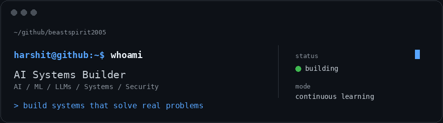
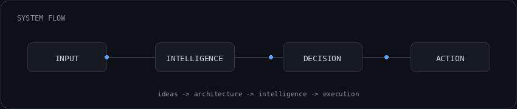
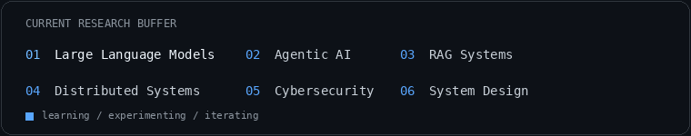

<div align="center">



<br>

### AI Systems Builder · Computer Science Student

Building intelligent systems across **AI, ML, LLMs, automation, software engineering and cybersecurity.**

<br>

`Python` · `C++` · `TypeScript` · `FastAPI` · `React` · `PostgreSQL` · `Docker` · `PyTorch` · `Ollama`

<br><br>

**BUILD → BREAK → LEARN → IMPROVE**

</div>

---

## ABOUT

I like taking an idea from a rough concept to a working system.

My interests sit at the intersection of **artificial intelligence, backend engineering, system design and cybersecurity**. I enjoy experimenting with models, designing architectures, understanding systems under the hood, and turning prototypes into something actually usable.

```text
curiosity        -> explore the problem
engineering      -> design the system
experimentation  -> test the assumptions
iteration        -> make it better
```

---

## SELECTED WORK

<table>
<tr>
<td width="50%" valign="top">

### DIGITAL RAKSHAK

AI-powered Cyber Threat Intelligence platform focused on threat detection, intelligence mapping, security analysis and structured threat intelligence.

`Python` `PyTorch` `Neo4j` `PostgreSQL` `Redis`

</td>
<td width="50%" valign="top">

### GOALFORGE AI

AI-powered OKR and workforce intelligence platform with goal refinement, milestone planning, risk prediction and performance analytics.

`Next.js` `TypeScript` `FastAPI` `PostgreSQL` `Gemini` `Ollama`

</td>
</tr>
<tr>
<td width="50%" valign="top">

### NOVA

Modular desktop AI assistant designed around automation, system interaction, extensibility and intelligent assistance.

`Python` `PyQt` `Computer Vision` `AI`

</td>
<td width="50%" valign="top">

### KRISHIVEDA

Intelligent farming assistant combining machine learning and data-driven decision support for agricultural use cases.

`Python` `ML` `Computer Vision` `Data Science`

</td>
</tr>
</table>

<br>

<div align="center">

</div>

---

## ENGINEERING STACK

| AREA | TECHNOLOGIES |
|:---|:---|
| **Languages** | `Python` `C` `C++` `Java` `SQL` `JavaScript` `TypeScript` |
| **AI / ML** | `PyTorch` `TensorFlow` `Keras` `scikit-learn` `LLMs` `RAG` `Computer Vision` |
| **Backend** | `FastAPI` `Flask` `Node.js` `PostgreSQL` `Redis` `REST APIs` |
| **Frontend** | `React` `Next.js` `HTML` `CSS` `Tailwind` |
| **Infrastructure** | `Docker` `Git` `GitHub` `Linux` `Ollama` |

---

## CURRENTLY EXPLORING

<div align="center">

</div>

---

## ENGINEERING MINDSET

<table>
<tr>
<td align="center" width="25%">

### 01

**UNDERSTAND**

</td>
<td align="center" width="25%">

### 02

**BUILD**

</td>
<td align="center" width="25%">

### 03

**BREAK**

</td>
<td align="center" width="25%">

### 04

**IMPROVE**

</td>
</tr>
</table>

I care about more than getting a demo to work. I like understanding **why** it works, where it fails, and how the architecture can evolve.

---

## FIND ME

<div align="center">

<a href="https://github.com/beastspirit2005">

</a>
&nbsp;
<a href="https://www.linkedin.com/in/harshit-sharma-802044373/">

</a>
&nbsp;
<a href="mailto:harshit2500sharma@gmail.com">

</a>

<br><br>

<code>Curious by default. Disciplined by choice.</code>

</div>
